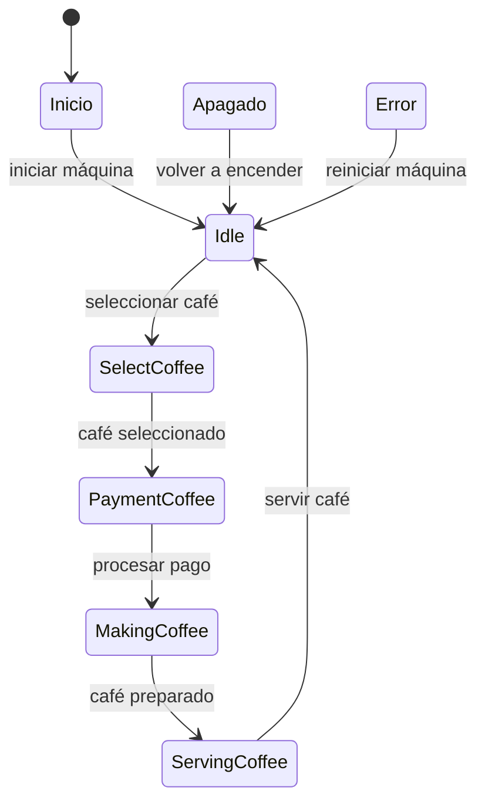

# Estados de la máquina de café

Este documento describe los estados y las transiciones de la máquina de café desarrollada en Kotlin mediante una máquina de estados.

## Estados

| Estado          | Descripción                                                                                                                                                                        |
| --------------- | ---------------------------------------------------------------------------------------------------------------------------------------------------------------------------------- |
| `Inicio`        | Estado inicial de la máquina. Cuando se ejecuta, la máquina se inicia y pasa al estado `Idle`.                                                                                     |
| `Idle`          | Estado de espera. La máquina está encendida y preparada para seleccionar un café. Después pasa a `SelectCoffee`. Guarda un `timestamp` con la fecha y hora de creación del estado. |
| `SelectCoffee`  | Permite seleccionar el tipo de café. En este programa se selecciona un café de tipo `Nescafe`. Después pasa a `PaymentCoffee`.                                                     |
| `PaymentCoffee` | Representa el proceso de pago del café seleccionado. Cuando se procesa el pago, pasa al estado `MakingCoffee`.                                                                     |
| `MakingCoffee`  | Representa la preparación del café. La máquina espera dos segundos y, cuando termina, pasa a `ServingCoffee`.                                                                      |
| `ServingCoffee` | Indica que el café está listo para servirse. Después de servirlo, la máquina vuelve al estado `Idle`.                                                                              |
| `Apagado`       | Representa la máquina apagada. Cuando se ejecuta este estado, la máquina vuelve a `Idle`.                                                                                          |
| `Error`         | Representa un error en la máquina. Muestra un mensaje con la información del error y vuelve a `Idle`.                                                                              |

Los estados se definen mediante una clase `sealed class`, que permite representar los diferentes estados posibles de la máquina. Los estados que necesitan guardar información utilizan `data class`, mientras que `Inicio` se define como un `object`.

## Transiciones

* `Inicio → Idle`: la máquina se inicia.
* `Idle → SelectCoffee`: la máquina queda preparada y selecciona un café.
* `SelectCoffee → PaymentCoffee`: se ha seleccionado el tipo de café.
* `PaymentCoffee → MakingCoffee`: se procesa el pago y comienza la preparación.
* `MakingCoffee → ServingCoffee`: el café termina de prepararse.
* `ServingCoffee → Idle`: el café se sirve y la máquina vuelve al estado de espera.
* `Apagado → Idle`: la máquina vuelve al estado de espera.
* `Error → Idle`: se muestra el error y la máquina vuelve al estado de espera.

## Flujo habitual

El funcionamiento normal de la máquina sigue este orden:

1. La máquina comienza en el estado `Inicio`.
2. Pasa a `Idle`, donde queda preparada.
3. Selecciona el café en `SelectCoffee`.
4. Procesa el pago en `PaymentCoffee`.
5. Prepara el café en `MakingCoffee`.
6. Sirve el café en `ServingCoffee`.
7. Vuelve a `Idle` para quedar preparada para otro café.

## Diagrama de estados

## Funcionamiento del programa

La clase `CoffeeMachine` utiliza un `object` para gestionar el estado actual mediante la variable `currentState`. El método `gestorEstados()` muestra el estado actual, ejecuta las acciones correspondientes y actualiza el estado de la máquina.

La función `main()` llama tres veces al método `gestorEstados()`, permitiendo observar cómo va cambiando el estado en cada llamada.

La máquina mantiene su estado entre llamadas, por lo que cada ejecución de `gestorEstados()` continúa el proceso desde el estado en el que quedó anteriormente.
